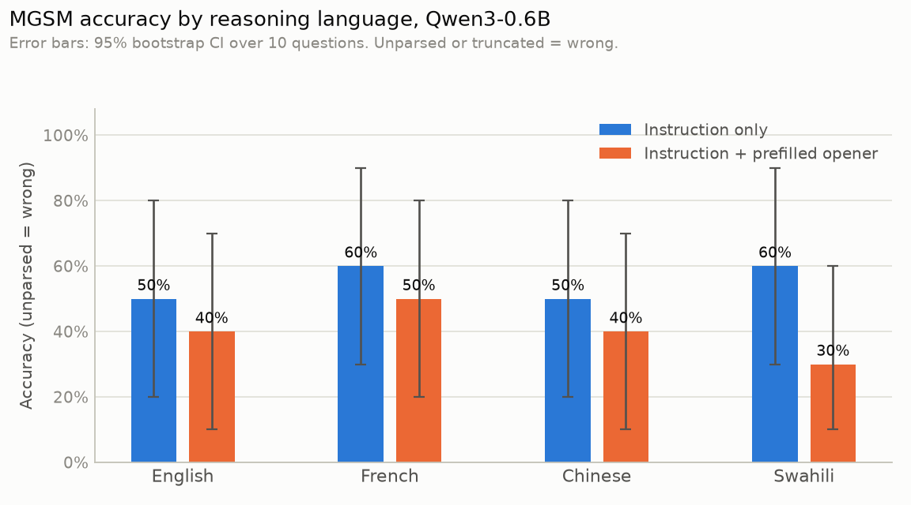
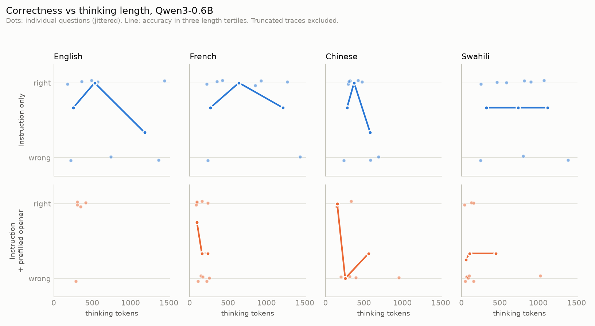

# Results: Qwen/Qwen3-0.6B

Source `results/dev/local_dev.jsonl`: 80 rows, 10 questions, seed 0, max_new_tokens 1536. CIs are percentile bootstrap (2,000 resamples over questions). Unparseable and truncated rows count as incorrect.

## Accuracy by reasoning language (all items)

| arm | lang | n | accuracy | 95% CI | unparsed | truncated | complied | mean % in target lang | median trace tokens |
|---|---|---|---|---|---|---|---|---|---|
| instruct_en | en | 10 | 50% | [20%, 80%] | 20% | 20% | 100% | 99% | 657 |
| instruct_en | fr | 10 | 60% | [30%, 90%] | 20% | 20% | 0% | 0% | 892 |
| instruct_en | zh | 10 | 50% | [20%, 80%] | 20% | 20% | 0% | 0% | 448 |
| instruct_en | sw | 10 | 60% | [30%, 90%] | 10% | 10% | 0% | 0% | 810 |
| prefill | en | 10 | 40% | [10%, 70%] | 50% | 50% | 100% | 99% | 976 |
| prefill | fr | 10 | 50% | [20%, 80%] | 0% | 0% | 90% | 88% | 154 |
| prefill | zh | 10 | 40% | [10%, 70%] | 20% | 20% | 100% | 98% | 322 |
| prefill | sw | 10 | 30% | [10%, 60%] | 0% | 0% | 0% | 3% | 92 |

## Paired difference vs English (same questions, within arm)

| arm | lang | pairs | acc diff | 95% paired CI | lang right / en wrong | lang wrong / en right |
|---|---|---|---|---|---|---|
| instruct_en | fr | 10 | +0.10 | [+0.00, +0.30] | 1 | 0 |
| instruct_en | zh | 10 | +0.00 | [+0.00, +0.00] | 0 | 0 |
| instruct_en | sw | 10 | +0.10 | [+0.00, +0.30] | 1 | 0 |
| prefill | fr | 10 | +0.10 | [+0.00, +0.30] | 1 | 0 |
| prefill | zh | 10 | +0.00 | [-0.40, +0.40] | 2 | 2 |
| prefill | sw | 10 | -0.10 | [-0.30, +0.00] | 0 | 1 |

## Accuracy on compliant items only

| arm | lang | n compliant | accuracy | 95% CI |
|---|---|---|---|---|
| instruct_en | en | 10 | 50% | [20%, 80%] |
| prefill | en | 10 | 40% | [10%, 70%] |
| prefill | fr | 9 | 44% | [11%, 78%] |
| prefill | zh | 10 | 40% | [10%, 70%] |

## Accuracy by trace-length bin (pooled tertiles, truncated excluded)

| arm | lang | tokens | n | accuracy |
|---|---|---|---|---|
| instruct_en | en | 37-221 | 1 | 100% |
| instruct_en | en | 222-424 | 2 | 50% |
| instruct_en | en | 424-1443 | 5 | 60% |
| instruct_en | fr | 37-221 | 1 | 100% |
| instruct_en | fr | 222-424 | 2 | 50% |
| instruct_en | fr | 424-1443 | 5 | 80% |
| instruct_en | zh | 222-424 | 5 | 80% |
| instruct_en | zh | 424-1443 | 3 | 33% |
| instruct_en | sw | 222-424 | 2 | 50% |
| instruct_en | sw | 424-1443 | 7 | 71% |
| prefill | en | 222-424 | 5 | 80% |
| prefill | fr | 37-221 | 7 | 57% |
| prefill | fr | 222-424 | 3 | 33% |
| prefill | zh | 37-221 | 4 | 75% |
| prefill | zh | 222-424 | 3 | 33% |
| prefill | zh | 424-1443 | 1 | 0% |
| prefill | sw | 37-221 | 9 | 33% |
| prefill | sw | 424-1443 | 1 | 0% |

## Figures

